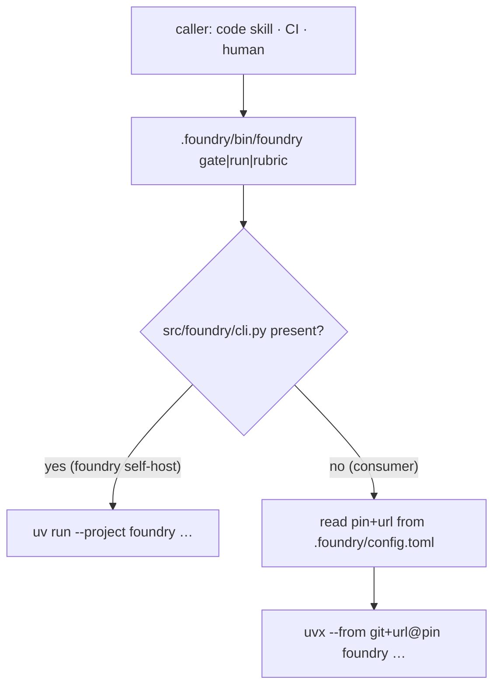

> **Status:** In progress (2026-07-03) — tracked on the [board](../../ROADMAP.md).

# foundry-cli-shim — design

A repo-local `.foundry/bin/foundry` shim: the one pin-free entry point every caller uses,
resolving the pinned CLI from `.foundry/config.toml`. It is the prerequisite for the
`code` skill (a session can't call a bare `foundry`) and it collapses the two-places pin
that pin-sync (PR #83) syncs — treating the cause.

## Decisions

- **D1 The shim is self-host-aware — one byte-identical template, right behavior in each
  repo.** It carries no pin; it reads one. In foundry's own repo (detected by
  `src/foundry/cli.py`) it runs the local tree (`uv run --project`); elsewhere it reads
  `pin`/`repo_url` from `.foundry/config.toml` and runs `uvx --from "git+<url>@<pin>"`. This
  generalizes the existing pre-push self-host divergence into the shim, so the same
  verbatim bytes satisfy the byte-identity gate and behave correctly everywhere.
- **D2 The shim lives in foundry's namespace, `.foundry/bin/foundry`.** Not `scripts/` —
  conv 5 deleted foundry scripts from there; the shim is foundry-owned glue reading foundry
  config, so it belongs beside `config.toml`/`manifest.json`. Discovery is the `code`
  skill's job (it calls the path); no human types it. `.foundry/bin/` is not gitignored
  (only `runs/`,`tmp/`,`reports/` are).
- **D3 The pin collapses to `config.toml`.** Bootstrap writes the pre-push hook as
  `exec .foundry/bin/foundry gate`; m006 rewrites existing consumers' hooks and CI likewise.
  The hardcoded `@tag` disappears from hooks/CI; the pin lives once. pin-sync (v0.2.4)
  becomes a no-op for shim-adopting repos — kept for legacy repos that still hardcode a tag.
- **D4 Foundry's own hook stays local-tree, unchanged.** m006 does not apply to foundry
  (its hook carries no hardcoded pin, and its conv bumps to 6 with the shim added by hand).
  The verbatim template hook stays foundry's local-tree form; only consumers are rewritten
  — the established divergence pattern. Routing foundry's hook through the shim too is a
  later simplification, out of scope here (it touches the load-bearing self-host gate).

## Public surface

| Surface | Change |
|---|---|
| `.foundry/bin/foundry` | new **verbatim template** (executable, marker `foundry-shim v1`): self-host-aware forwarder to the repo's foundry CLI |
| `src/foundry/materializer/migrations/m006_cli_shim.py` | new migration: install the shim, rewrite pre-push + CI to `.foundry/bin/foundry gate`, bump `conventionVersion` 5→6 |
| migration registry (`migrations/README.md`, `update._migrations`) | head → 6; `m006` row + registration |
| `src/foundry/materializer/bootstrap.py` | fresh pre-push becomes `exec .foundry/bin/foundry gate`; shim installs via the existing `rglob` verbatim copy |
| foundry `.foundry/manifest.json` | `conventionVersion` 5→6; `.foundry/bin/foundry` tracked (self-host copy) |

## Invariants

- `.foundry/bin/foundry` is byte-identical to `src/foundry/templates/verbatim/.foundry/bin/foundry`
  modulo the marker line (self-host byte-identity gate).
- The shim carries no pin — it reads `config.toml` — so it is static across releases and
  never needs repinning.
- After bootstrap or m006, the pinned `@tag` appears in `config.toml` only, never in the
  pre-push hook or CI.
- `m006.applies` fires only when the shim is absent and the hook hardcodes a pin; it is
  idempotent (a conv-6 repo never re-triggers).
- Registry head == foundry manifest `conventionVersion` (`check-gate-tools.sh`), both 6.

## Migration detector (m006)

`applies(repo)` is true when: manifest `conventionVersion == 5` AND `.foundry/bin/foundry`
is absent. The shim's absence is the structural signal the migration removes — installing it
flips the detector off. The hook rewrite keys on the pinned-gate line
(`uvx --from "git+…@…" foundry gate`); a repo already routing through the shim is left alone.

## Flow

## Skill dispositions (spec stage)

- `naming-standards` — `.foundry/bin/foundry` mirrors the CLI name; marker `foundry-shim`
  joins the `foundry-template:` family.
- `modular-structure` — the shim is repo-boundary glue in foundry's control dir; the CLI
  package is untouched.
- `design-patterns` — self-host detection is a Strategy chosen at runtime by repo shape;
  one template, two execution paths.
- `performance` — N/A (a forwarding exec).
