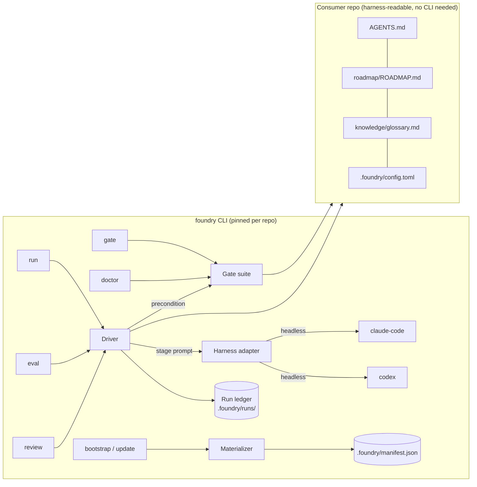
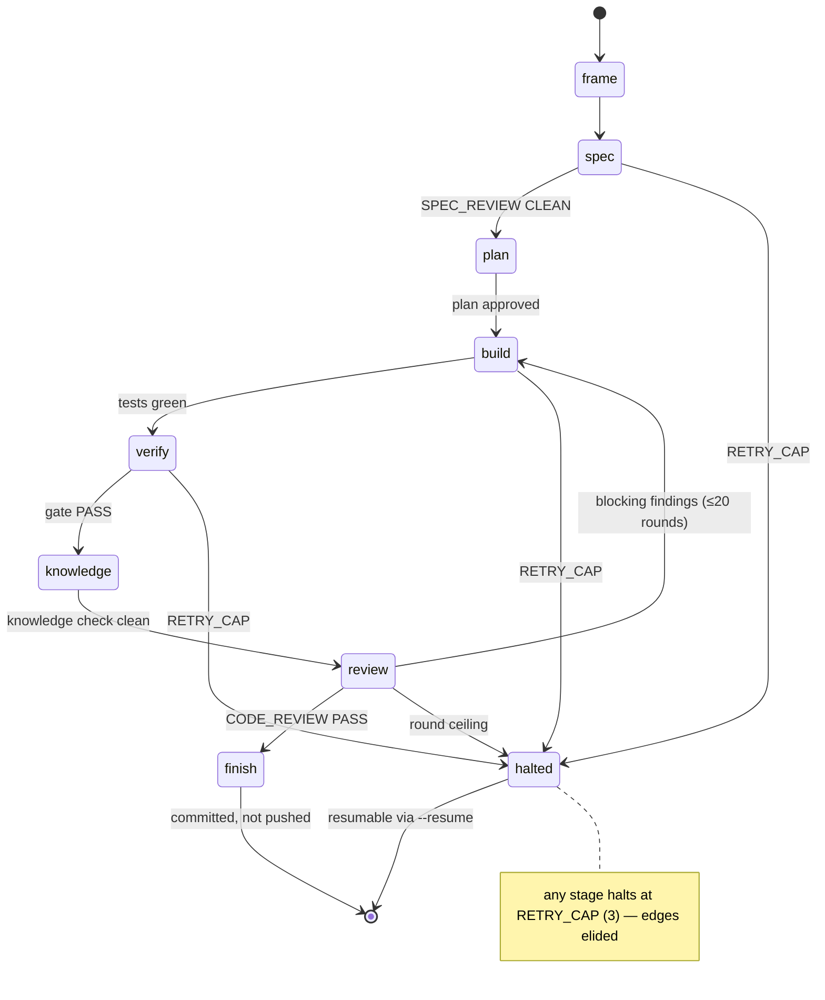
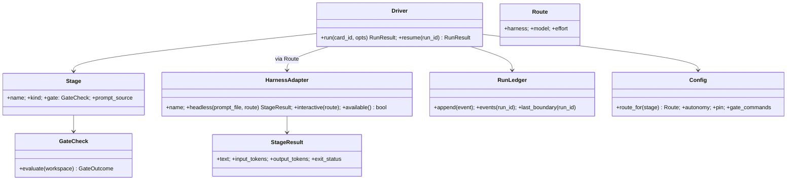

> **Status:** Done (2026-07-02) — spec approved and implemented (Epic 8); tracked on the [board](../../ROADMAP.md).

# foundry-v2 — design

## Shape

One inversion drives everything: v1 is judgment all the way down (prose mechanics,
LLM-executed), v2 is a **deterministic core with a judgment shell**. Code owns whatever
has one right answer — file materialization, hashing, migrations, stage transitions, gate
evaluation, event recording. Skills own whatever needs judgment — interviews, design,
build, review, knowledge placement. The seam between them is the **stage prompt**: the
driver compiles one from the stage's rubric(s) and card context (D8), hands it to a
harness through an adapter, and judges the result only by the stage's gate.



## Decisions

### D1 — Driver as a state machine over the v1 lifecycle

The driver runs the same eight stages the `code` skill defines — the lifecycle is proven;
only its enforcement changes. Stage kinds:

| Stage | Kind | Driver does | Gate (checked in code) |
|---|---|---|---|
| frame | mechanical | resolve card, branch + worktree, autonomy/stop-point from config | card resolved, worktree exists |
| spec | judgment | harness writes/updates `roadmap/specs/<feature>/` | `SPEC_REVIEW: CLEAN` marker from a fresh-context review call |
| plan | judgment | harness writes `tasks.md`; board status update staged | tasks.md exists; approval per autonomy level |
| build | judgment | harness implements per tasks.md in the worktree | `[gate].test` exits 0 |
| verify | mechanical | run the canonical gate | the canonical gate command exits 0 (`[gate].commands` in Waves 1–2; `foundry gate` from Wave 3) |
| knowledge | mixed | harness places knowledge; driver runs the mechanical check | knowledge check clean, index regenerated |
| review | judgment | reviewer + refuter convergence loop, driver-owned | `CODE_REVIEW: PASS`; ≤ 20 rounds then halt |
| finish | mechanical | commit in worktree (explicit paths), board status staged in the diff | committed; nothing pushed |

Plan's tasks.md check is live (`run_command.build_gates`, `_plan_gate`); finish's worktree
commit and knowledge's mechanical check remain unwired and land in later waves (knowledge
check: Wave 3 T11).

Gates are **preconditions evaluated by code** — the driver runs a command or greps a
marker; it never asks the model whether the gate passed. Command-shaped gates (build's
`[gate].test`, verify's canonical gate command) pass on exit 0, marker-agnostic — so
`check-fast: PASS` (this repo, Waves 1–2) and `gate: PASS` (Wave 3 on) both satisfy
verify by exit status. Judgment-quality concerns
(naming, design fitness) stay the reviewing harness's job inside spec/review stages; the
driver enforces only what is mechanically checkable. The review-convergence loops that
v1 runs as hook scripts (`code-review-convergence-hook.sh`) become driver-owned loops:
same logic, deterministic ownership; the scripts are deleted in Wave 4 (TR-3, D7).

**Stage hooks (AC-1.9).** A repo customizes the lifecycle without forking foundry by
dropping `.foundry/hooks/<stage>.{pre,post}.sh` — the skill-hooks spec's convention,
now with the guarantee that parked it: the driver runs hooks at boundaries
deterministically, a failing pre hook blocks entry, a failing post hook fails the gate,
and both land in the ledger. One deliberate change from that spec: the executable bit
replaces `.foundry/hooks.json`'s `enabled` array as the opt-in — one artifact fewer,
and the driver already bounds execution to stage boundaries, the seam where SDLC
customization stays; tool-event gating remains the harness's native hooks, per the
skill-hooks research.



Paths other than new-feature reuse the same machine with stages skipped: bug fix enters
at build; refactor enters at build with the feature-file check disabled; enhancement
enters at spec with a light-spec flag. The entry map lives in `driver/stages.py`, not in
prose; enhancement's light-spec variant is the `--light-spec` flag.

### D2 — Harness adapter: data for shape, code for parsing, fixtures for drift

An adapter is a TOML file shipped in the package (`src/foundry/adapters/<name>.toml`):

```toml
name = "claude-code"

[instruction]
file = "AGENTS.md"
pointer = "CLAUDE.md"        # symlink emitted when this harness is selected

[headless]
command = ["claude", "-p", "@{prompt_file}", "--output-format", "stream-json", "--verbose",
           # --verbose: required by claude CLI >= 2.1.198 when combined with -p --output-format stream-json
           "--permission-mode", "acceptEdits", "--model", "{model}"]
effort_args = ["--effort", "{effort}"]   # appended only when effort is set
parser = "claude-stream-json"

[interactive]
command = ["claude", "--model", "{model}"]
```

Command templates are argv lists with `{model}`, `{effort}`, `{prompt_file}`,
`{workspace}` placeholders — never shell strings (no injection surface). Parsers are code
(`adapters/parsers.py`, one per output format) returning a normalized
`StageResult(text, input_tokens, output_tokens, exit_status)`. Each adapter carries
conformance fixtures — recorded real transcripts under
`tests/fixtures/adapters/<name>/` — so a harness CLI changing its output format turns up
as a red fixture, not a runtime surprise — conformance runs in this repo's test suite;
the shipped package carries no fixtures. In a consumer repo, `doctor` checks adapter
availability (command on PATH, auth probe — the glossary's *harness availability*).

Permission posture: headless runs use the harness's accept-edits tier scoped to the
card's worktree — not the bypass-everything flag v1's spawn scripts use; the worktree is
the blast radius.

### D3 — Routing table with defaults at the boundary

`.foundry/config.toml` is the one human-owned config file (the manifest stays
machine-written):

```toml
[foundry]
pin = "v2.0.0"                 # git tag of the foundry repo
repo_url = "https://github.com/bmransom/foundry"

[gate]
test = "uv run pytest -q"         # build-stage gate: the repo's test command
commands = ["scripts/check-heavy.sh"]   # repo-specific additions to `foundry gate` (verify stage)

[autonomy]
level = "guided"               # supervised | guided | autonomous
stop_point = "card"            # feature | card | epic | roadmap (the glossary Stop-point set)

[routing.default]
harness = "claude-code"
model = "claude-opus-4-8"

[routing.stage.build]
model = "claude-sonnet-5"

[routing.stage.review]
effort = "high"
```

Resolution: CLI flag > `[routing.stage.<stage>]` > `[routing.default]` > shipped
defaults in `config.py` — one boundary, per the code-review Defaults rule (a value
defaults once, at the highest layer a caller can supply it).

Harness selection has two artifacts with distinct jobs: the manifest's `harnesses` set
records which instruction files bootstrap emitted (repo intent); the routing table
decides per-stage execution. A routed harness must be in the manifest set — `doctor`
checks it.
Shipped defaults route frame/verify/finish to no model (mechanical), build and
knowledge's judgment half to a mid-tier model, spec/plan/review to the top tier; the
map lives in `config.py`.

### D4 — Run ledger: wide events, append-only, gitignored

`.foundry/runs/<run-id>/events.jsonl`, one JSON object per line. `run-id` =
`r-<UTC yyyymmddHHMMSS>-<4 hex>`. Event names: `run_started`, `stage_started`,
`stage_completed`, `gate_evaluated`, `hook_evaluated`, `run_halted`, `run_resumed`,
`run_completed`.

```json
{"event":"stage_completed","run_id":"r-20260702170312-a1b2","card_id":"v2-driver",
 "stage":"build","harness":"claude-code","model":"claude-sonnet-5","effort":null,
 "input_tokens":91234,"output_tokens":8123,"cost_usd":1.87,"duration_s":412,
 "gate":{"name":"tests","outcome":"PASS"},"ts":"2026-07-02T17:10:04Z"}
```

Cost: `cost_usd` computed from a price table in `ledger.py` (per-model $/Mtok constants
with a `prices_updated` date; unknown model → tokens recorded, cost null). The ledger is
the raw zone — gitignored, local — consistent with the signal store's committed/raw
split; the self-improving loop promotes summaries, never raw events. Resume reads the
last `stage_completed` to find the boundary (AC-1.6).

### D5 — Pinned run replaces vendoring

A consumer repo carries no foundry scripts. `.githooks/pre-push` and CI both run:

```sh
uvx --from "git+https://github.com/bmransom/foundry@v2.0.0" foundry gate
```

`uvx` caches per tag, so steady-state cost is process startup. The pin is written twice:
`config.toml` is the source of truth, and the bootstrap-written hook embeds the pinned
URL so the zero-install property holds on first clone; `foundry doctor` and the AC-5.4
warning catch drift between the two. In this repo, `check-fast.sh` becomes the
`[gate].commands` entry, so its checks (and its PASS marker) run inside `foundry gate`.
`foundry gate` subsumes the v1
gate tools — `check-board.py`, `prose-lint.py`, `knowledge.py check` port into
`src/foundry/gate/` as modules — plus the repo's own `[gate].commands`. The
`# foundry-gate-tool:` marker convention retires with vendoring: the gate suite is code
in one place, versioned by the pin. This is a convention break (migration in Wave 3).

### D6 — Materializer: templates in the package, migrations as modules

Templates move from `plugins/foundry/templates/` to `src/foundry/templates/` (same
verbatim/seed split; generated stays a judgment product). `foundry bootstrap` = interview
(judgment) → deterministic copy/fill → manifest stamp → verify. `foundry update` =
hash-compare → apply `src/foundry/materializer/migrations/m<NNN>_<name>.py` in order from
the repo's convention version → restamp. Each migration is a module with
`applies(repo) -> bool` and `apply(repo) -> None`, mirroring the glossary's Angular
schematics prior art. The v1 playbooks (conv 2–4) port as the first migration modules so
v2 can update any existing v1 repo; the pinned-run module is written as code in Wave 3
(T13), which allocates the next free convention number when it ships. The self-host byte-identity check follows the
templates in the same PR (TR-2).

### D7 — In-place rebuild, wave-gated deletion

v2 lands in this repo behind the existing gate. Each wave that replaces a v1 mechanism
deletes it in the same PR (TR-3): Wave 1 deletes nothing (driver runs alongside skills);
Wave 3 deletes vendored gate-tool templates and the marker lint; Wave 4 deletes the
prose update/bootstrap mechanics, the tmux spawn scripts, and the convergence-hook
scripts that ride them (`code-review-convergence-hook.sh`, `spec-convergence-hook.sh`,
`spec-convergence-posttooluse.sh`); retires the `code`, `handoff`, `spec-review`,
`code-review`, and `knowledge` skill files (D8 — rubrics + driver stages replace them);
and reshapes `extract-skill` off the fresh-session runner in the same PR, so no kept
skill references a deleted script.

### D8 — Skill layer: stage rubrics, orchestration stripped

v1 skills mixed three kinds of content because the agent sequenced the lifecycle. Each
has a distinct fate under the driver:

| v1 content | Fate | Examples |
|---|---|---|
| Orchestration — sequencing, worktree/board/commit mechanics, gate discipline | Moves into the driver; the prose deletes. "Don't rationalize past a gate" scaffolding becomes unnecessary — a precondition cannot be rationalized past. | `code`'s checklist + gate table; `handoff` (the ledger and `--resume` replace it); `bootstrap`/`update` mechanics (D6) |
| Stage judgment — what good looks like at one lifecycle stage | Extracted into a **stage rubric**: intent, invariants, and an output contract; one file per stage with a judgment half (spec, plan, build, knowledge, review) in `src/foundry/rubrics/<stage>.md`. The source skill files (`spec-review`, `code-review`, `knowledge`) retire in Wave 4; `foundry run --stage` and `foundry review` are the interactive surfaces | spec authoring (from `code` §1 + `spec-review`), review dimensions + severity gate (from `code-review`), knowledge placement (from `knowledge`) |
| Advisory judgment — method content invocable on demand | Unchanged home (`plugins/foundry/skills/`), doubly consumed: interactively on any harness as today, and composed into stage prompts by `prompts.py` per the stage→rubric map in `stages.py`. `extract-skill` is reshaped off the fresh-session runner in Wave 4 (it runs inline; fresh context is a headless adapter call) | `naming-standards`, `design-patterns`, `modular-structure`, `performance`, `debug`, `extract-skill` |

Two rules keep the boundary honest. A rubric never carries an orchestration verb —
worktree, commit, board, push are driver vocabulary; T6's golden-file tests seed one and
must fail. And every rubric whose stage gate reads harness output ends with its **output
contract** — the last-line marker or JSON verdict its stage's GateCheck parses
(`SPEC_REVIEW: CLEAN`, `CODE_REVIEW: PASS|FAIL`, a findings array) — so those gates
read declared output, never free text; build's and plan's command-shaped gates pass on
exit status (D1).

**Public surface and invariants (AC-10.4/10.5).** The spec rubric requires `design.md`
to declare the feature's public surface (types, signatures, wire formats, config keys)
and its invariants (what must always hold) — the artifacts the naming, design-pattern,
and structure rubrics compose over. The spec stage's output contract carries
`open_questions`: an unresolved invariant or surface decision becomes a question the
driver raises at the stage boundary per the autonomy dial — supervised and guided ask
the user; autonomous records the assumption in `design.md` and flags the run. The
spec-format seed gains the same two sections (specs-readme v4, with a discriminating
eval case) so human-authored specs carry them too. Rubrics state intent and invariants, not step-by-step procedure: the routed
model expands them to its own tier, which is what makes per-model skill variants
unnecessary (Out of scope) until ledger data says otherwise.

`harness-deliberation` is untouched (Out of scope). Skills removed or reshaped keep
their eval cases: the reviewer eval and lifecycle eval repoint at rubrics when the
stages they grade move.

## Module layout

```
pyproject.toml               # name "foundry", console script foundry = foundry.cli:main
src/foundry/
  cli.py                     # argparse dispatch: run, gate, doctor, runs, eval, review, bootstrap, update
  config.py                  # config.toml + manifest.json load; precedence; shipped defaults
  ledger.py                  # event dataclasses, append/read, run ids, price table
  board.py                   # run-time card resolver: ROADMAP table parse, near-match errors (distinct from gate/board.py)
  run_command.py             # `foundry run` wiring: worktree create/reuse, gate construction, adapter callable
  driver/
    machine.py               # stage graph, preconditions, retry caps, halt/resume
    stages.py                # stage definitions: kind, gate, stage→rubric map, entry map per path
    prompts.py               # stage-prompt compilation: rubric(s) + card context (D8)
  rubrics/                   # one stage rubric per judgment stage (D8)
  adapters/
    __init__.py              # TOML load, template expansion, availability probe
    parsers.py               # claude-stream-json, codex-jsonl → StageResult
    claude_code.toml
    codex.toml
  gate/
    suite.py                 # runs checks + [gate].commands; prints gate: PASS|FAIL
    board.py prose.py knowledge.py   # ports of check-board.py / prose-lint.py / knowledge.py
  doctor.py
  materializer/              # migrations/ starts Wave 3 (T13); bootstrap.py, update.py Wave 4
  review/pr.py               # Wave 5: gh-backed PR review transport
tests/                       # pytest; fixtures under tests/fixtures/
```



## New vocabulary

Glossary entries land with the first implementing card; coined here with prior art:

| Term | Definition | Prior art |
|---|---|---|
| **Driver** | The deterministic state machine that runs the lifecycle: compiles stage prompts, invokes harnesses, evaluates gates as preconditions, records the run ledger. | In-repo: skill-hooks research named "a deterministic lifecycle driver" the consensus answer; test-driver vocabulary. |
| **Harness adapter** | A per-harness TOML declaring instruction-file mapping and command templates, backed by a named parser and conformance fixtures. | GoF Adapter; extends v1's harness map (`harness-agnostic` spec). |
| **Stage prompt** | The prompt the driver compiles for a judgment stage: the stage's rubric(s) plus card context. | Prompt-template vocabulary (LangChain et al.), constrained to lifecycle stages. |
| **Stage rubric** | A judgment stage's content contract: intent, invariants, and an output contract — never orchestration (driver vocabulary). | Assessment-rubric vocabulary (education), constrained to lifecycle stages. |
| **Run ledger** | The append-only, gitignored JSONL event log per driver run, carrying wide-event fields including tokens and cost. | Event-sourcing; reuses the in-repo *ledger* sense (Session storage tier, Candidate ledger). |
| **Routing table** | The config mapping stage → (harness, model, effort), resolved flag > stage > default > shipped. | Network routing tables; LLM-router systems (RouteLLM). |
| **Pinned run** | Executing the CLI at the repo-pinned git tag via ephemeral `uvx`, replacing vendored scripts. | Pinned-dependency / lockfile vocabulary; `npx`/`uvx` ephemeral execution. |
| **Materializer** | The code that writes templates into a consumer repo — bootstrap's copy/fill and update's migrations — deterministic and idempotent. | Build-system "materialize" / materialized-view vocabulary; operates on the glossary's Template classes. |
| **Conformance fixture** | A recorded real harness transcript under `tests/fixtures/adapters/<name>/` that an adapter's parser must handle; a red one means the harness CLI drifted. | xUnit fixture sense — distinct from the glossary **Fixture** (a small repo under `evals/fixtures/` that evals run against). |
| **Pytest repo fixture** | A minimal git repo under `tests/fixtures/repos/` that unit and smoke tests run against — test-local, never an eval target. | xUnit fixture sense, same family as Conformance fixture; distinct from the glossary **Fixture**. |
| **Gate suite** | The code-owned check set `foundry gate` runs: the board/prose/knowledge modules plus the repo's `[gate].commands`. | xUnit test-suite vocabulary; extends the glossary **Gate** term. |

`doctor` follows `brew doctor` / `flutter doctor` and stays a command name, not a
glossary term. "Executor" is avoided — the glossary reserves it for finding
verification.

## Metrics

| Signal | Measure |
|---|---|
| Gate integrity | Ledger-derived count of stage entries whose predecessor gate lacks a PASS event — structurally 0; any nonzero is a COE. |
| Cost per run / per stage | `cost_usd` sums from the ledger; establishes the baseline routing decisions are judged against. |
| Unattended completion | Fraction of `foundry run` invocations reaching `run_completed` without a human unblock, per autonomy level. |
| Adapter conformance | Fixture suite green per adapter per release; a red fixture blocks release. |
| Eval matrix discrimination | Per harness×model cell: seeded defects caught / seeded (target 1.0), decoys flagged (target 0). |

## Rejected alternatives

- **Graceful degradation (keep vendored scripts)** — dual maintenance of every gate tool;
  pinned run keeps zero-install with one implementation.
- **Per-harness native hooks for enforcement** — already rejected by the skill-hooks
  research: SDLC stages are not tool-events; the driver is that research's conclusion.
- **Evolve the prose mechanics in place** — keeps the unreliable chassis that motivated
  v2; the byte-identity gate would remain a patch over prose copying.
- **Go/Rust or Node CLI** — a single static binary is not worth losing stdlib TOML/JSON,
  pytest, and direct reuse of the three Python gate tools; uvx makes Python zero-install
  anyway.
- **Bypass-permissions headless runs (v1 spawn behavior)** — accept-edits scoped to the
  card worktree gives the same throughput with a real blast-radius boundary.

## Open risks

- **Subscription rate limits**: headless runs draw on interactive plan quotas (the
  pr-review-runner research); the ledger's cost column is the early-warning instrument.
- **Harness CLI drift**: output formats are not contracts; conformance fixtures convert
  drift into a red test. Recording fresh fixtures is a documented chore, not a surprise.
- **Stage-prompt quality**: a compiled prompt may under-perform the interactive skill
  flow; the eval matrix (US-8) is the check, and `--interactive` is the escape hatch.
