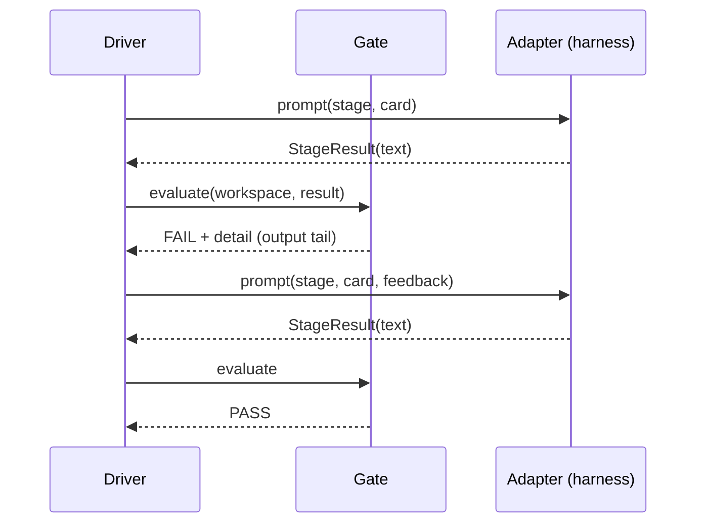
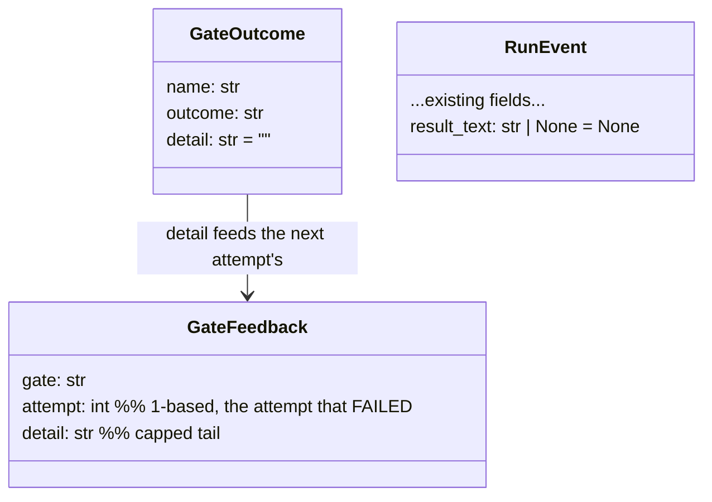

> **Status:** In progress (2026-07-03) — tracked on the [board](../../ROADMAP.md).

# gate-feedback — design

**Gate feedback**: a failed gate's evidence, fed by the driver into the retried stage's
prompt. Prior art: closed-loop control (feedback), CI failure reporting. The prompt
stays a pure function — now of (stage, rubrics, card, feedback) instead of silently
omitting the fourth input.

## Decisions

- **D1 Feedback is an explicit parameter, not workspace state.** A frozen
  `GateFeedback(gate, attempt, detail)` travels machine → adapter →
  `compile_stage_prompt`. `attempt` is the 1-based number of the attempt that
  **failed** (attempt 2's prompt reports attempt 1's failure). One feedback slot,
  latest evidence wins: a fresh FAIL replaces prior feedback — never accumulates —
  so prompts stay bounded. Rejected: a well-known failure file in the worktree —
  stateful, survives across runs, invisible in signatures.
- **D2 Evidence originates in the gate.** `GateOutcome` gains `detail: str = ""`.
  The command gate captures the command's output (stdout+stderr merged, decoded with
  `errors="replace"` — untrusted bytes never crash a run), writes it through to the
  driver's stdout after the command exits, and keeps a capped tail as detail. The
  trade: live streaming and stream separation go away on gate commands (the
  interactive path still inherits stdio). The marker gate reports the value it saw;
  the plan gate the path it missed; a failing post hook its exit code.
- **D3 Review findings ride the same channel.** Review FAIL → build re-entry passes
  `GateFeedback("CODE_REVIEW", round, tail(gate detail + review text))` — the gate's
  own detail leads, so a review post-hook FAIL never feeds evidence that contradicts
  the failure; the findings follow in the text tail. The second blind loop (20-round
  ceiling) closes with the same mechanism, not a parallel one. Inside the re-entered
  build, a build-gate FAIL replaces the review feedback (D1's latest-evidence rule);
  build's retry count starts fresh each re-entry, as today — `REVIEW_ROUND_CEILING`
  bounds the outer loop.
- **D4 The ledger persists the stage's returned text, capped.** `RunEvent` gains
  `result_text: str | None`; the machine records `tail(StageResult.text)` on
  `gate_evaluated`. Old events parse (field defaults None). The wide event stays one
  line; the cap keeps it bounded.
- **D5 The rubric tells the agent to run the repo's test command (`[gate].test`).**
  One Output-contract line in `rubrics/build.md`. Content only — no orchestration
  verb, so the validator still passes.

## Public surface

| Surface | Change |
|---|---|
| `foundry.driver.machine.GateFeedback` | new frozen dataclass: `gate: str`, `attempt: int`, `detail: str` |
| `foundry.driver.machine.GateOutcome` | new field `detail: str = ""` |
| `foundry.driver.machine.Adapter` (Protocol) | `__call__(stage, route, workspace, feedback: GateFeedback \| None = None)` |
| `foundry.driver.machine.FEEDBACK_DETAIL_CAP` | `4000` chars — tail cap for gate detail |
| `foundry.driver.machine.RESULT_TEXT_CAP` | `4000` chars — tail cap for persisted result text |
| `foundry.driver.prompts.compile_stage_prompt` | new kwarg `feedback: GateFeedback \| None = None`; renders a `## Previous attempt failed its gate` section between rubrics and card context |
| `foundry.ledger.RunEvent` | new field `result_text: str \| None = None` (wire: `events.jsonl` key) |
| `foundry.run_command.AdapterCallable` | signature widens to accept `feedback` |
| `src/foundry/rubrics/build.md` | Output contract instructs running the repo's test command before finishing |

## Invariants

- A first attempt's compiled prompt is byte-identical to the pre-feature prompt for the
  same (stage, rubrics, card).
- Every post-FAIL judgment/mixed attempt's prompt carries the failed gate's name and
  detail; review → build re-entry carries the review tail. No judgment retry is blind
  (mechanical stages run no prompt; their retries are unchanged).
- `detail` and `result_text` are tails capped at their constants; prompts and events
  never grow unboundedly.
- `events.jsonl` stays append-only wide events; files written before this change still
  parse.
- Rubrics carry no orchestration verb (`validate_rubric` unchanged and green on the
  edited `build.md`).

## Metrics

From the run ledger: **recovery rate** — the fraction of stage `gate_evaluated` FAILs
followed by a PASS on the same stage in the same run (a retry that corrected), versus
`run_halted` at the retry cap. `r-20260703023624-22b6` is the baseline: 0 of 3 build
attempts recovered.

## Flow

## Skill dispositions (spec stage)

- `naming-standards` — applied: **gate feedback** coined with prior art above;
  `detail`/`result_text` follow the existing wide-event field style.
- `design-patterns` — applied: explicit-parameter data flow over shared state (D1);
  the widened `Adapter` Protocol is the seam.
- `modular-structure` — applied: evidence originates in gates (machine), renders in
  prompts, persists in the ledger event the machine already builds; no new module.
- `performance` — bounded by the two caps; no hot path. Otherwise N/A.
- Eval case — the lifecycle eval harness is stubbed (pending rubric repoint), so the
  rubric edit ships with discriminating unit tests (validator green, prompt carries
  feedback) instead of an eval-matrix case; noted, not skipped silently.
